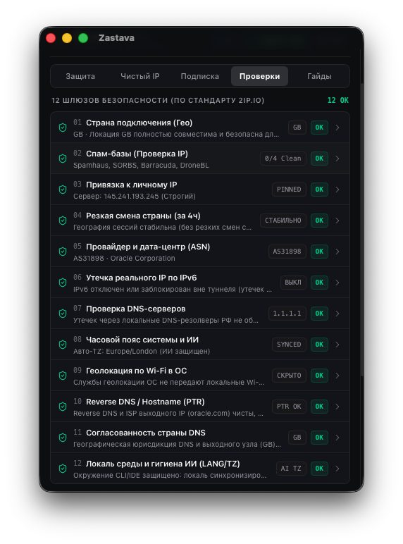
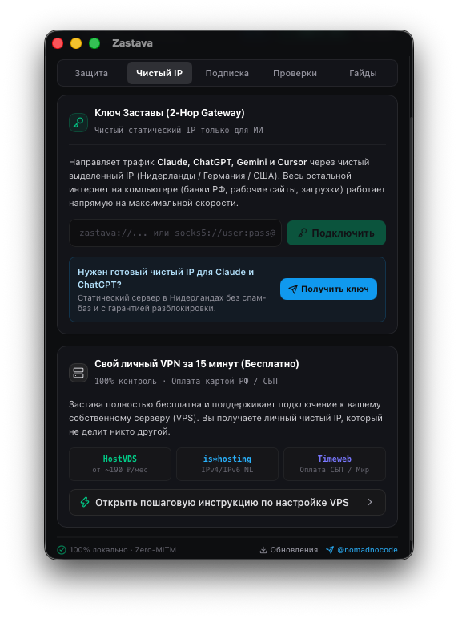
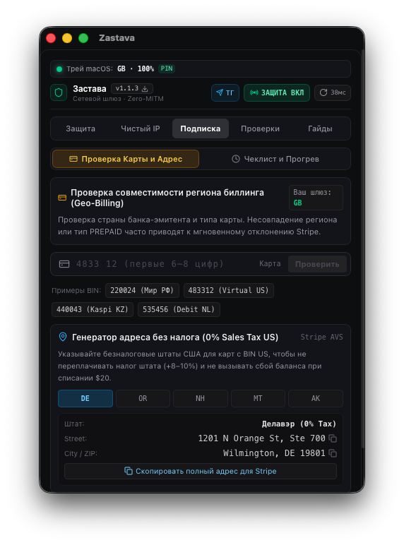
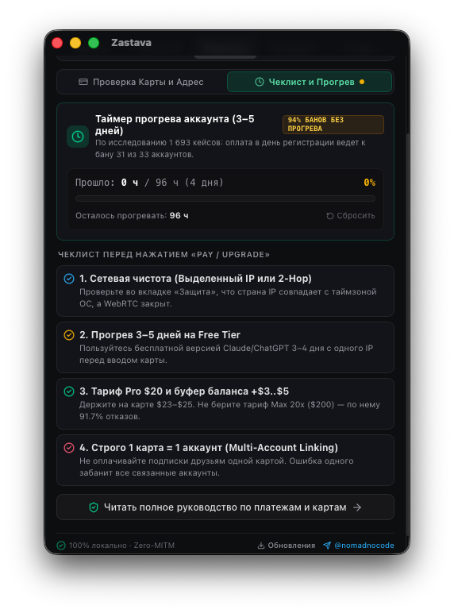
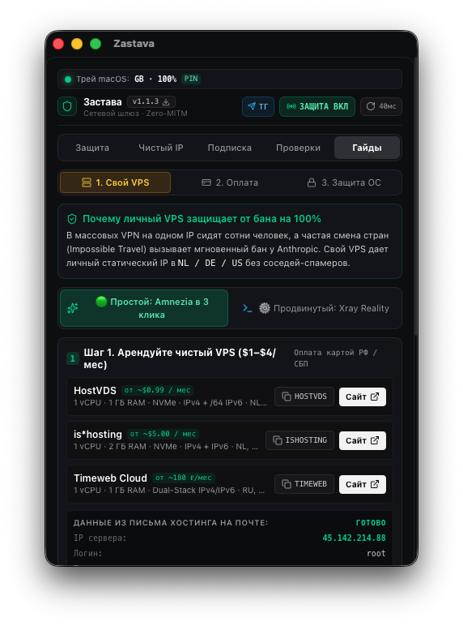
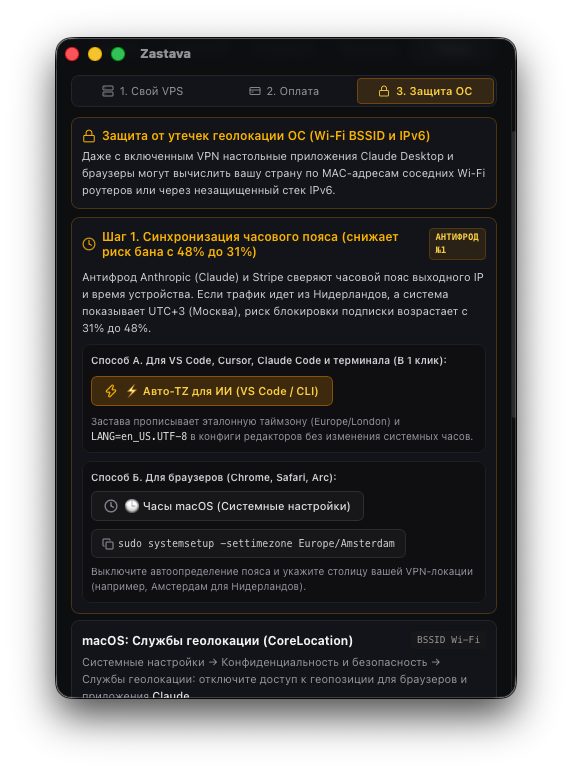
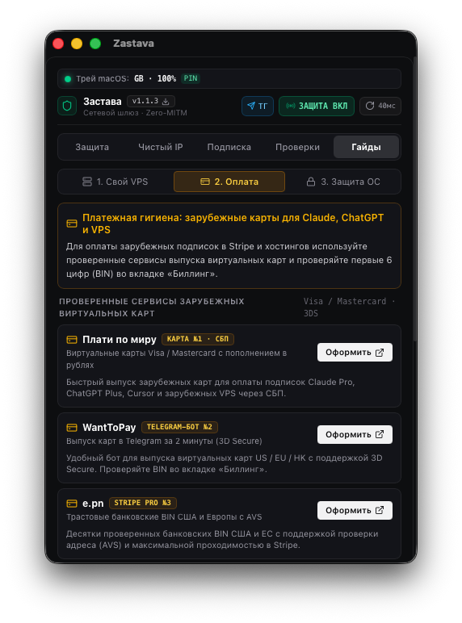

<div align="center">
  

  # Застава (`Zastava`)

  **Интеллектуальный сетевой шлюз и монитор стабильности подключений для безопасной и бесперебойной работы с облачными платформами и ИИ-ассистентами (Claude, ChatGPT, Google Gemini, Cursor, Antigravity)**

  [](LICENSE)
  [](#сборка-и-запуск-из-исходного-кода)
  [](src-tauri/)
  [](#архитектура-безопасности-сквозной-tls-туннель)
  [](https://github.com/kingbest1195/ai-antiban/releases/latest)

  <p align="center">
    <a href="#скачать-готовые-сборки"><b>Скачать сборку</b></a> ·
    <a href="#что-делает-застава">Возможности</a> ·
    <a href="#скриншоты-интерфейса">Скриншоты</a> ·
    <a href="#12-контуров-сетевого-аудита">12 контуров аудита</a> ·
    <a href="#архитектура-безопасности-сквозной-tls-туннель">Приватность</a> ·
    <a href="#сборка-и-запуск-из-исходного-кода">Сборка</a>
  </p>
</div>

---

## Скачать готовые сборки

Все установочные пакеты компилируются автоматически через открытый GitHub Actions Workflow:

- **macOS (Apple Silicon M1/M2/M3/M4 и Intel x86_64)**: [Скачать Universal .dmg (последний релиз)](https://github.com/kingbest1195/ai-antiban/releases/latest) (скачайте и перетащите в папку Applications).
- **Windows (x64)**: [Скачать установщик .exe или .msi (последний релиз)](https://github.com/kingbest1195/ai-antiban/releases/latest).
- **Встроенное автообновление**: если у вас уже установлена Застава, нажмите кнопку «Обновления» внутри приложения для фоновой установки в 1 клик (или настройте автообновление через окно настроек).

---

## Зачем нужна «Застава»?

При профессиональной разработке и длительных рабочих сессиях с зарубежными облачными платформами и ИИ-инструментами (Claude Code, ChatGPT, Gemini, Cursor, Antigravity) даже кратковременный сетевой сбой приводит к аварийному разрыву сессии, сбросу контекста и риску блокировки аккаунта:

1. **Разрыв туннеля (Kill-Switch Gap)**: большинство VPN-клиентов закрывают сетевой шлюз с задержкой 1.5–3 секунды. Фоновые запросы CLI-агентов и IDE успевают уйти с вашего реального IP до срабатывания защиты.
2. **Цепные блокировки на одном компьютере (Device Fingerprinting)**: клиент Claude Desktop сохраняет постоянный идентификатор устройства (`ant-device-registry.json`) и общие сессионные куки. Если один аккаунт попадает под подозрение, робот связывает все профили на этой же машине и банит их по цепочке, даже при смене почты и IP.
3. **Скачки локаций (`Impossible Travel`)**: автоматическое переключение серверов меняет страну сессии за доли секунды, что мгновенно фиксируется системами безопасности провайдеров.
4. **Страх скрытых утечек при смене сети**: разработчики боятся переключать VPN или Wi-Fi во время генерации ответа ИИ, опасаясь, что одиночный просочившийся пакет приведет к потере подписки.
5. **Рассинхронизация часового пояса и системной локали**: отправка запросов из европейского IP при системном времени MSK и региональных маркерах выдает несоответствие рабочего окружения.
6. **Потеря контекста и памяти при смене аккаунта**: консольный Claude Code сохраняет десятки проектов, планов и файлов долгосрочной памяти локально в `~/.claude`. При смене аккаунта все эти наработки обычно теряются.
7. **Несовместимость платежных реквизитов**: оплата подписок картой страны, не совпадающей со страной рабочего шлюза, приводит к отклонению транзакций платежными шлюзами.

---

## Что делает «Застава»?

**Застава** работает как локальный интеллектуальный фильтр Layer 5 перед отправкой сетевого трафика:

- **Мгновенный перехват разрывов (<250 мс) под челкой экрана (Dynamic Island HUD)**: ядро Rust непрерывно сверяет локальную таблицу маршрутизации ОС (`Kernel UDP Route Fingerprint`). При малейшем обрыве VPN соединение мгновенно замораживается на уровне сокета до отправки пакета в провод, а сверху под челкой дисплея плавно выезжает информационная капсула с вариантами действий.
- **Изоляция профилей Claude Desktop (Anti-Chain-Ban)**: переключение между рабочим, личным и запасным аккаунтами в 1 клик. Для каждого профиля Застава генерирует уникальный изолированный `device_id` в `ant-device-registry.json`, разделяет кэш сессий (`ccd-ids.json`, cookies) и жестко привязывает выделенный IP. Бан одного профиля физически изолирован от остальных, а конфиги MCP (`claude_desktop_config.json`) остаются в безопасности.
- **Интерактивный краш-тест обрыва VPN (Safe Canary Probe)**: встроенная безопасная симуляция падения сетевого туннеля прямо в интерфейсе. Отправляет канареечный запрос на изолированный домен `canary-test.anthropic.zastava.local` и замеряет скорость перехвата в миллисекундах (<0.05 мс), наглядно подтверждая 0 байт утечки в реальную сеть без риска для боевых чатов.
- **Тихий фоновый режим на Windows (Silent Background Execution)**: все системные вызовы инспекции сетевых маршрутов, DNS, адаптеров и управления прокси выполняются с флагом `CREATE_NO_WINDOW (0x08000000)`. Больше никаких моргающих черных окон консоли `cmd.exe` поверх рабочих программ.
- **Полный контроль обновлений и сетевая прозрачность**: отдельное окно настроек с тумблером полного отключения автопроверки релизов и честным отчетом обо всех локальных портах (`127.0.0.1:8899`, `127.0.0.1:1420`) и внешних эндпоинтах. Промпты, ключи и переписка никогда не отправляются на сторонние серверы.
- **Живой пульс защиты**: прозрачный раздельный учет защищенных запросов ИИ (Claude, ChatGPT, Gemini, Antigravity Cloud Code), удержанных сетевых утечек и прямого транзита для не-ИИ трафика (`Git`, `NPM`, `Cargo`, обычные сайты идут напрямую на полной скорости канала без задержек).
- **Пульт управления в системном трее**: живая сводка отбитых сетевых сбоев и защищенных запросов ИИ, быстрое переключение профилей, бэкап данных Claude, тумблеры защиты терминала и запуск краш-теста прямо из строки меню / области уведомлений.
- **12 контуров аудита сетевого окружения**: одновременная проверка гео-матрицы провайдеров, 4 баз DNSBL, фиксации эталонного IP (IP Pinning), скачков перемещения, репутации автономных систем (ASN), утечек IPv6, DNS-резолверов, консистентности страны DNS, Reverse DNS PTR, локали ОС и статуса фоновой телеметрии, с кнопками исправления проблем в 1 клик.
- **Защита терминала и IDE в 1 клик**: автоконфигурация прокси `127.0.0.1:8899` для VS Code, Cursor, Windsurf, Claude Code и терминала (`~/.zshrc`). При закрытии Заставы настройки автоматически восстанавливаются в исходное состояние.
- **Синхронизация часового пояса ИИ без смены часов компьютера**: в 1 клик прописывает переменную `TZ` в `~/.zshenv` и конфиги редакторов, согласуя время для CLI-агентов с IP вашего шлюза, сохраняя ваши привычные системные часы macOS и Windows.
- **Резервное копирование и перенос контекста Claude Code (`~/.claude`)**: находит все сессии (`.jsonl`), планы (`plans/`) и долгосрочную память (`MEMORY.md`), упаковывает их в единый архив на Рабочем столе с наглядной картой проектов (`INDEX_SUMMARY.md`) и генерирует универсальный промт (`RESTORE_PROMPT.md`) для мгновенного развертывания контекста в любом ИИ-харнессе (Cursor, Antigravity, Windsurf, новом аккаунте Claude).
- **Глубокий сброс кэша и сетевых маркеров**: удаляет временные Cookies, Network State и локальные метки Electron в клиентах Claude Desktop и ChatGPT, сохраняя пользовательские конфиги MCP-серверов (`claude_desktop_config.json`) и рабочие проекты.
- **Селективный 2-Hop шлюз (Custom Upstream Gateway)**: подключение вашего статического VPS (SOCKS5/HTTP) для маршрутизации исключительно ИИ-трафика, оставляя весь остальной трафик системы прямым.
- **Помощник подписки и совместимости биллинга (Geo-Billing)**: встроенный валидатор банковских карт (BIN-чекер) для проверки совпадения страны карты и рабочего шлюза, генератор безналоговых адресов США (0% Sales Tax в DE, OR, NH, MT, AK) и таймер 96 часов прогрева новых аккаунтов.

---

## Скриншоты интерфейса

| Главный экран «Защита» | 12 шлюзов безопасности | Чистый IP (2-Hop Gateway) |
| :---: | :---: | :---: |
|  |  |  |

| Geo-Billing & Валидатор карт | Чеклист и Прогрев 96ч | Перехват под чёлкой macOS |
| :---: | :---: | :---: |
|  |  |  |

| Личный VPS (Amnezia / Xray) | Синхронизация часового пояса | Платёжная гигиена |
| :---: | :---: | :---: |
|  |  |  |

---

## 12 контуров сетевого аудита

| № | Контур аудита | Что проверяет ядро Rust | Инженерная цель |
| :-: | :--- | :--- | :--- |
| **01** | **Гео-матрица платформ (`Страна × Сервис`)** | Сверка страны выхода со спецификациями доступности ИИ | Предотвращает запросы из неподдерживаемых регионов |
| **02** | **Базы репутации IP (`DNSBL`)** | Параллельный опрос 4 баз: `Spamhaus ZEN`, `SORBS`, `Barracuda`, `DroneBL` | Выявляет скомпрометированные подсети до авторизации |
| **03** | **Контроль выделенного узла (`IP Pinning`)** | Сравнение текущего IP с закрепленным эталоном | Замораживает сессии при малейшем сбое выделенного туннеля |
| **04** | **Контроль резкой смены локаций (`Impossible Travel`)** | Локальный журнал географии сессий за 12 часов | Предупреждает о подозрительной смене страны/континента |
| **05** | **Репутация автономной системы (`ASN`)** | Проверка номера ASN по реестру дата-центров | Выявляет перегруженные транзитные сети хостинг-провайдеров |
| **06** | **Двухстековая утечка `IPv6`** | Проверка глобальных IPv6-маршрутов в обход туннеля | Защищает от раскрытия реального провайдера через IPv6 |
| **07** | **Системные DNS-резолверы** | Инспекция `scutil --dns` (macOS) и сетевых адаптеров Windows | Обнаруживает нежелательные запросы к DNS местного провайдера |
| **08** | **Синхронизация часового пояса (`TZ`)** | Сравнение системной таймзоны с локацией выхода шлюза | Устраняет расхождения между системным временем и сетью |
| **09** | **Консистентность страны DNS** | Сверка геолокации DNS-сервера со страной шлюза | Предотвращает утечки через зарубежные DNS нецелевых стран |
| **10** | **Проверка `Reverse DNS PTR`** | Запрос PTR-записи IP выхода через системный резолвер | Исключает использование «грязных» узлов с подозрительными PTR |
| **11** | **Гигиена системной локали (`Locale Hygiene`)** | Проверка соответствия языкового окружения ОС и CLI | Предотвращает передачу конфликтующих локалей в заголовках |
| **12** | **Системная телеметрия и свежесть маршрутов** | Контроль интервалов обновления сетевых дескрипторов | Гарантирует актуальность данных аудита в пределах 60 секунд |

---

## Архитектура безопасности: сквозной TLS-туннель

В отличие от инструментов, использующих подмену корневых SSL/TLS сертификатов:

- **Сквозной TLS-туннель**: локальный шлюз (`127.0.0.1:8899`) работает исключительно на уровне заголовка `HTTP CONNECT (Layer 5)`. Ваши промпты, токены сессий, программный код и API-ключи передаются внутри зашифрованного сквозного TLS-туннеля напрямую к целевым серверам без расшифровки и чтения.
- **Fail-Closed PAC-скрипт**: при временной приостановке соединения трафик не утекает в открытую сеть напрямую.
- **Защита от открытого прокси (SSRF-Safe)**: шлюз принимает запросы исключительно к явно авторизованному списку доменов ИИ-провайдеров (`claude.ai`, `anthropic.com`, `chatgpt.com`, `openai.com`, `gemini.google.com`, `daily-cloudcode-pa.googleapis.com` и др.).
- **100% локальная приватность**: приложение работает автономно на вашей машине, не содержит сторонней аналитики и скрытой телеметрии.

---

## Сборка и запуск из исходного кода

Проект является полностью открытым и собирается локально:

### Системные требования
* **Node.js 22+** и менеджер пакетов **pnpm**
* **Rust (stable)** и компилятор `cargo`

```bash
# 1. Клонирование репозитория
git clone https://github.com/kingbest1195/ai-antiban.git
cd ai-antiban

# 2. Установка зависимостей интерфейса
pnpm install

# 3. Запуск автоматических тестов ядра (89 unit-, security- и интеграционных тестов)
cargo test --manifest-path src-tauri/Cargo.toml

# 4. Запуск приложения в режиме разработчика
pnpm tauri dev

# 5. Сборка релизного пакета для вашей операционной системы
pnpm tauri build
```

---

## Лицензия

Проект распространяется под открытой лицензией **MIT**. Разрешено свободное использование в личных и коммерческих целях.
