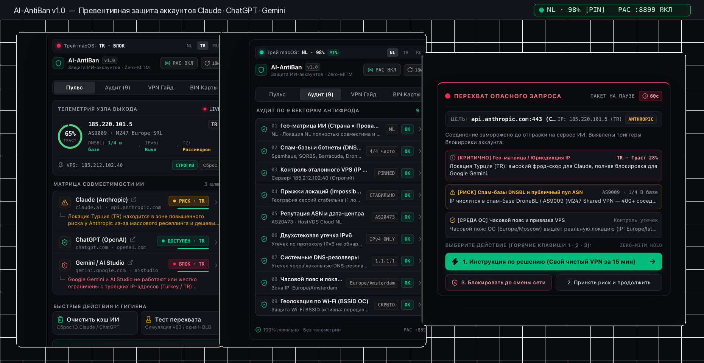
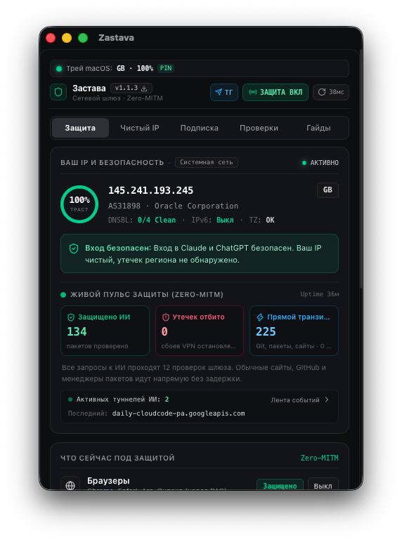
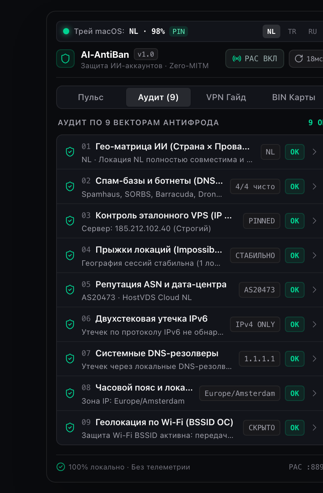
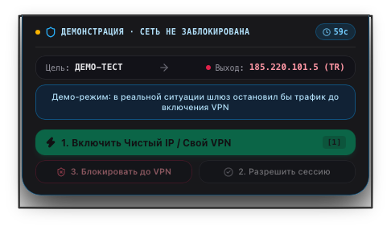

<div align="center">
  

  # AI-AntiBan (`v1.0.0`)

  **Десктопный фаервол и аудитор антифрод-рисков для защиты аккаунтов Claude, ChatGPT и Google Gemini от внезапных банов (РФ / СНГ)**

  [](https://github.com/kingbest1195/ai-antiban/releases/latest)
  [](https://github.com/kingbest1195/ai-antiban/releases/latest)
  [](src-tauri/)
  [](#-архитектура-безопасности-zero-mitm)

  <p align="center">
    <a href="https://github.com/kingbest1195/ai-antiban/releases/latest"><b>⬇ Скачать для macOS (.dmg) и Windows (.exe / .msi)</b></a> ·
    <a href="#-как-это-работает">Как это работает</a> ·
    <a href="#-9-векторов-аудита-антифрода">9 векторов проверки</a> ·
    <a href="#-быстрый-запуск-и-установка">Установка</a>
  </p>
</div>

---



## Проблема: почему банят оплаченные аккаунты Claude Pro, ChatGPT Plus и Gemini?

В 90% случаев блокировка прилетает **не за промпты**, а из-за автоматических срабатываний антифрод-систем (`Cloudflare Turnstile`, `Stripe Radar`, `Arkose Labs`) при смене сетевого окружения:

1. **Забытый или упавший VPN (Kill-Switch Gap)** — открытая вкладка `claude.ai` или десктопное приложение отправляет фоновый запрос напрямую с IP РФ/РБ.
2. **Прыжки по странам в бесплатных/шаред VPN (`Impossible Travel`)** — утром вход из Нидерландов (`NL`), днем автовыбор переключил на Турцию (`TR`) или США (`US`).
3. **Конфликт юрисдикций ИИ-сервисов** — например, с турецкого IP (`TR`) работает ChatGPT, но **Google Gemini блокируется**, а у **Anthropic Claude** включается повышенный фрод-скор.
4. **Грязные пулы IP (`M247`, `Datacamp`, `Tzulo`) и спам-базы (`DNSBL`)** — когда на одном IP сидят еще 400 пользователей бесплатного VPN.
5. **Тихие утечки ОС** — утечка реального провайдера через `IPv6`, системные DNS (`77.88.8.8`), рассинхрон часового пояса (`Europe/Moscow` при IP в Амстердаме) и геолокация по Wi-Fi роутерам (BSSID).

---

## Что делает AI-AntiBan?

**AI-AntiBan** живет в строке меню macOS (Menu Bar) и системном трее Windows, отображая живой статус соединения прямо рядом с часами (`NL · 98% 📌`, `TR · РИСК`, `RU · БЛОК`, `HOLD`) и защищая ваши аккаунты **до того**, как пакет уйдет на сервер ИИ:

- **Живой индикатор в трее / Menu Bar** — мгновенная видимость страны выхода, траст-скора (0–100%) и статуса привязки личного VPS без необходимости открывать окно.
- **Селективный PAC-перехватчик (`127.0.0.1:8899`)** — заворачивает **только** обращения к доменам `claude.ai`, `chatgpt.com`, `openai.com`, `gemini.google.com`, `aistudio.google.com`. Весь остальной трафик (YouTube, Telegram, игры, банки) идет напрямую без задержек.
- **Экстренная заморозка пакета (`TCP Hold`)** — если VPN упал, сменился эталонный IP или обнаружен опасный ASN, прокси ставит `CONNECT`-соединение на паузу на 60 секунд и вызывает нативное окно перехвата поверх всех окон.
- **9-векторный антифрод-аудит за ~40 мс** — одновременная проверка геолокации, 4 спам-баз DNSBL, ASN-репутации, IPv6, DNS, часового пояса и BSSID.
- **Локальный чекер BIN платежных карт** — офлайн-проверка первых 6 цифр зарубежной карты на проходимость в `Stripe` и совпадение со страной вашего VPN.
- **Очистка локальных трекеров ИИ в 1 клик** — безопасный сброс кэша и `device_id` десктопных клиентов Claude и ChatGPT после смены прокси.

---

## Скриншоты интерфейса

| Панель «Пульс» и матрица ИИ | Глубокий аудит по 9 векторам | Экстренный перехват пакета (`TCP Hold`) |
| :---: | :---: | :---: |
|  |  |  |

---

## 9 векторов аудита антифрода

| № | Вектор проверки | Что проверяет движок Rust | Как предотвращает бан |
| :-: | :--- | :--- | :--- |
| **01** | **Гео-матрица ИИ (`Страна × Провайдер`)** | Сверка страны выхода с правилами каждого ИИ (`rules/provider_matrix.json`) | Предупреждает, что Турция (`TR`) безопасна для ChatGPT, но блокирует Gemini и триггерит фрод-скор у Claude |
| **02** | **Спам-базы и ботнеты (`DNSBL`)** | Параллельный опрос 4 баз: `Spamhaus ZEN`, `SORBS`, `Barracuda`, `DroneBL` | Выявляет «заспамленные» IP до авторизации в аккаунте |
| **03** | **Контроль эталонного VPS (`IP Pinning`)** | Сравнение текущего внешнего IP с вашим закрепленным сервером | В режиме `СТРОГИЙ` мгновенно замораживает трафик при малейшем сбое VPN |
| **04** | **Прыжки локаций (`Impossible Travel`)** | Локальный журнал географии сессий за последние 24 часа | Блокирует вход, если за 10 минут страна сменилась с Германии на США |
| **05** | **Репутация ASN и дата-центра** | Проверка номера автономной системы по базе публичных VPN-хостингов | Отсекает перегруженные шаред-сети (`AS9009 M247`, `AS60068 Datacamp`) |
| **06** | **Двухстековая утечка `IPv6`** | Проверка активных глобальных IPv6-маршрутов в обход IPv4-туннеля | Защищает от раскрытия домашнего провайдера РФ по IPv6 |
| **07** | **Системные DNS-резолверы** | Инспекция `scutil --dns` (macOS) и `ipconfig /all` (Windows) | Обнаруживает утечку запросов через DNS провайдера или `77.88.8.8` |
| **08** | **Часовой пояс и локаль ОС** | Сравнение системной таймзоны (`Europe/Moscow`) с географией IP | Предотвращает детекцию через `Intl.DateTimeFormat().resolvedOptions().timeZone` |
| **09** | **Геолокация по Wi-Fi (`BSSID ОС`)** | Проверка системных служб геолокации macOS / Windows | Закрывает вектор определения координат по MAC-адресам соседних роутеров |

---

## Быстрый запуск и установка

Готовые сборки доступны в разделе **[Releases](https://github.com/kingbest1195/ai-antiban/releases/latest)**:

### 🍏 macOS (Apple Silicon `M1/M2/M3/M4` и Intel)

1. Скачайте файл **`AI-AntiBan_1.0.1_aarch64.dmg`** (или `.app.tar.gz`) со страницы [последнего релиза](https://github.com/kingbest1195/ai-antiban/releases/latest).
2. Перетащите **AI-AntiBan.app** в папку `Applications` (`Программы`).
3. Так как приложение распространяется как открытый исходный код (Open Source) без платной подписки Apple Developer ID, при первом запуске снимите карантин Gatekeeper одной командой в Терминале:
   ```bash
   xattr -cr /Applications/AI-AntiBan.app
   ```
   > Если macOS пишет **«AI-AntiBan.app повреждён и не может быть открыт»** — это не поломка файла, а карантин Gatekeeper на скачанных из браузера приложениях без Apple Developer ID. Команда выше его снимает. Если приложение лежит не в `Applications`, укажите свой путь.
4. Запустите **AI-AntiBan** — в верхней строке меню (Menu Bar) появится иконка щита и живой статус вашего соединения (`NL · 98%`).

### 🪟 Windows (10 / 11 x64)

1. Скачайте установщик **`AI-AntiBan_1.0.1_x64-setup.exe`** или **`AI-AntiBan_1.0.1_x64_en-US.msi`** со страницы [Releases](https://github.com/kingbest1195/ai-antiban/releases/latest).
2. Запустите установщик (при появлении окна SmartScreen нажмите *«Подробнее» → «Выполнить в любом случае»*).
3. Иконка **AI-AntiBan** появится в системном трее рядом с часами.

---

## Архитектура безопасности (`Zero-MITM`)

В отличие от обычных прокси-расширений и антидетект-тулз, **AI-AntiBan**:
- **Не подменяет SSL-сертификаты (`Zero-MITM`)**: локальный сервер на `127.0.0.1:8899` работает исключительно на уровне заголовка `HTTP CONNECT (Layer 5)`. Ваши промпты, токены сессий, API-ключи и ответы нейросетей идут внутри зашифрованного TLS-туннеля напрямую к серверу ИИ.
- **Строгий Fail-Closed PAC-скрипт**: если соединение заблокировано вами в окне перехвата, браузер не сможет «тихо» отправить запрос напрямую в обход прокси.
- **Защита от SSRF**: локальный прокси принимает туннели только к белому списку доменов ИИ (`anthropic`, `openai`, `gemini`) и отклоняет любые сторонние хосты.
- **100% офлайн-приватность**: приложение не имеет собственных внешних серверов аналитики и не собирает телеметрию.

---

## Сборка из исходного кода

Требования: **Node.js 20+**, **pnpm**, **Rust (stable)**.

```bash
# 1. Клонирование репозитория
git clone https://github.com/kingbest1195/ai-antiban.git
cd ai-antiban

# 2. Установка зависимостей фронтенда
pnpm install

# 3. Запуск тестов ядра Rust (40 unit и интеграционных тестов)
cargo test --manifest-path src-tauri/Cargo.toml

# 4. Запуск в режиме разработки
pnpm tauri dev

# 5. Сборка релизного инсталлятора (.dmg / .app / .exe / .msi)
pnpm tauri build
```

---

## Лицензия

Распространяется под лицензией **MIT**. Свободно для личного и коммерческого использования.
