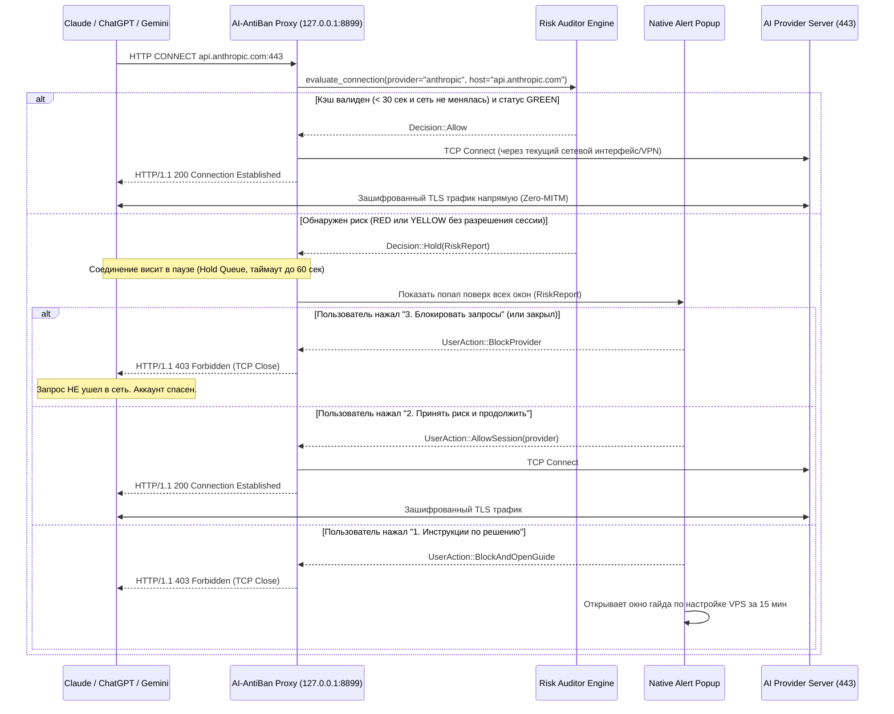

# 02. Техническая архитектура и кроссплатформенная спецификация (macOS + Windows)

## 1. Выбор технологического стека

Для реализации легковесного, безопасного и вызывающего доверие Open-Source приложения под **macOS (12+)** и **Windows (10/11)** выбран стек:

* **Ядро и системный демон (Backend):** **Rust (Tauri v2 Core + Tokio)**
  * *Почему Rust:* Нативная производительность, отсутствие сборщика мусора, минимальное потребление ОЗУ в фоне (~15–25 МБ), идеальная поддержка асинхронного TCP-проксирования (`tokio::net::TcpListener`), прямой доступ к системным вызовам macOS (`networksetup`, `scutil`) и Windows (`winreg`, `WinInet` API).
* **Пользовательский интерфейс (Frontend):** **React 18 + TypeScript + TailwindCSS (Vite)** внутри нативного WebView (WebKit на macOS, WebView2 на Windows).
* **Размер дистрибутива:** ~4–7 МБ (`.dmg` для macOS Universal, `.msi` / `.exe` для Windows x64/ARM64).
* **Локальное хранилище состояния:** Локальный JSON-конфиг в пользовательской директории (`~/Library/Application Support/com.ai-antiban.app/state.json` на macOS, `%APPDATA%\com.ai-antiban.app\state.json` на Windows).

---

## 2. Архитектура перехвата трафика без MITM (Selective PAC + Connect Hold Proxy)

### 2.1. Почему не обычный системный прокси на весь трафик?
Если завернуть весь трафик ОС в локальный прокси, мы можем конфликтовать с системными VPN-клиентами (Amnezia, Streisand, V2Ray, Tun2Socks, Outline) и замедлять торренты/игры.
Поэтому используется **Selective Proxy Auto-Configuration (`proxy.pac`)**:

1. Локальный сервер AI-AntiBan поднимается на `127.0.0.1:8899` (с фолбэком на свободный порт).
2. На `GET http://127.0.0.1:8899/proxy.pac` он отдает динамический PAC-скрипт:

```javascript
function FindProxyForURL(url, host) {
    const aiDomains = [
        // Anthropic (Claude Web, Desktop, API)
        "claude.ai", "anthropic.com",
        // OpenAI (ChatGPT Web, Desktop, API, Auth)
        "chatgpt.com", "openai.com", "oaistatic.com", "oaiusercontent.com",
        // Google (Gemini, AI Studio, Vertex/Generative Language API)
        "gemini.google.com", "aistudio.google.com", "makersuite.google.com",
        "generativelanguage.googleapis.com", "alkalimakersuite-pa.clients6.google.com"
    ];

    for (var i = 0; i < aiDomains.length; i++) {
        var d = aiDomains[i];
        if (host === d || shExpMatch(host, "*." + d)) {
            return "PROXY 127.0.0.1:8899";
        }
    }
    return "DIRECT";
}
```

### 2.2. Жизненный цикл перехваченного запроса (State Machine)

Когда пользователь открывает Claude Desktop или пишет промпт в браузере:



---

## 3. Специфика интеграции с ОС (macOS vs Windows)

### 3.1. Настройка и очистка PAC-прокси

| Операция | macOS (`networksetup`) | Windows (`WinReg` + `WinInet`) |
| :--- | :--- | :--- |
| **Включение перехвата** | Определение активных сетевых сервисов (`Wi-Fi`, `Ethernet` и др.) и вызов: `networksetup -setautoproxyurl "<Service>" "http://127.0.0.1:8899/proxy.pac"` и `-setautoproxystate "<Service>" on`. | Запись в реестр текущего пользователя (не требует UAC/Admin): `HKCU\Software\Microsoft\Windows\CurrentVersion\Internet Settings` $\rightarrow$ `AutoConfigURL = "http://127.0.0.1:8899/proxy.pac"`, затем вызов `InternetSetOptionW(NULL, INTERNET_OPTION_SETTINGS_CHANGED, ...)` и `INTERNET_OPTION_REFRESH`. |
| **Корректный выход (Graceful Shutdown)** | При закрытии приложения (а также по `SIGINT`/`SIGTERM`/Crash handler при следующем старте) обязательно вызывается `-setautoproxystate "<Service>" off`, чтобы не оставить систему с неработающим прокси. | При выходе удаляется ключ `AutoConfigURL` из `HKCU\...\Internet Settings` и вызывается `InternetSetOptionW` для мгновенного сброса настроек браузеров и приложений. |
| **Детектор смены сети (Network Change Watcher)** | Мониторинг смены локального IP / интерфейса каждые 3 сек + сброс кэша аудитора при любом изменении маршрута по умолчанию (`route -n get default`). | Мониторинг смены сетевого интерфейса (`NotifyAddrChange` / опрос активного интерфейса) + сброс кэша аудитора. |

### 3.2. Защита от обхода системного прокси (Fallback-монитор)
Некоторые CLI-утилиты или кастомные сборки могут игнорировать системный `PAC`-файл. Для них в AI-AntiBan предусмотрен:
1. **Индикатор и автоэкспорт переменных окружения** (`HTTPS_PROXY=http://127.0.0.1:8899` для терминала / Claude Code CLI).
2. **Активный фоновый монитор сети:** даже если приложение не делает запрос в данный момент, фоновый воркер при отвале VPN мгновенно меняет иконку в трее на 🔴 и может выбросить превентивное уведомление: *«Внимание! VPN отключился, ваш IP сейчас из РФ. Не открывайте Claude!»*.

---

## 4. Структура модулей проекта

```text
ai-antiban/
├── LICENSE                         # MIT License
├── PRIVACY.md                      # Zero-Telemetry Манифест
├── README.md                       # Описание для GitHub и пользователей из Threads
├── docs/                           # Полная документация и ТЗ для разработки
│   ├── 01-PRD-and-Analysis.md
│   ├── 02-Architecture-and-OS-Spec.md
│   ├── 03-Risk-Engine-and-Provider-Matrix.md
│   ├── 04-UI-UX-and-Monetization-Spec.md
│   └── 05-Development-Tasks-and-Test-Plan.md
├── rules/                          # Обновляемые правила и гайды (база знаний)
│   ├── provider_matrix.json        # Матрица стран и правил по провайдерам
│   ├── dangerous_asns.json         # Список заспамленных ASN и запрещенных регионов
│   └── guides/                     # Markdown-гайды с нативной монетизацией
│       ├── 01-personal-vpn-15min.md
│       ├── 02-safe-payment-cards.md
│       └── 03-os-privacy-setup.md
├── src-tauri/                      # Rust Backend (Tauri v2)
│   ├── Cargo.toml
│   ├── tauri.conf.json
│   └── src/
│       ├── main.rs
│       ├── lib.rs
│       ├── proxy/                  # HTTP CONNECT & PAC сервер + Hold Queue
│       ├── auditor/                # Сетевой аудитор (IP, ASN, DNS, Timezone, Geo Matrix)
│       ├── sysproxy/               # Управление прокси для macOS и Windows
│       ├── bin_checker/            # Локальный чекер BIN платежных карт
│       └── state/                  # Хранение истории IP, Pinned IP и сессионных разрешений
└── src/                            # Frontend (React + TypeScript + Tailwind)
    ├── App.tsx
    ├── components/
    │   ├── Dashboard.tsx           # Главное окно (статус по 3 провайдерам, IP Pinning)
    │   ├── AlertPopup.tsx          # Экстренный попап с 3 кнопками при перехвате
    │   ├── GuideViewer.tsx         # Встроенный ридер гайдов и партнерских ссылок
    │   └── BinCheckerModal.tsx     # Проверка первых 6 цифр карты
```
